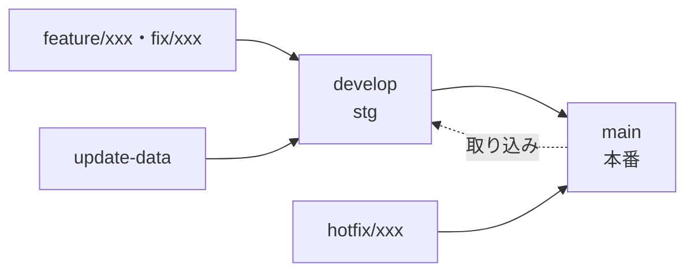

# ブランチ戦略

「しのうたタイム」の Git のブランチと、Streamlit Community Cloud の環境の対応、日々の作業からリリースまでの手順をまとめます。

## 今の運用(2026-10)

- 運用は、持ち主1人と AI(Claude Code など)です。**PR(GitHub のプルリクエスト)の運用は未定です【要確認】。** 決まるまでは、持ち主が手元で merge と push を行います(下の手順)。
- **`main`・`develop` への統合(merge)と push は、持ち主が手で行います。** AI は行いません。`.claude/settings.json` で、AI の `git push`・`git merge`・`git rebase`・`git checkout main|develop`・`git switch main|develop` を禁止しています。下の手順の merge・push は、持ち主が打つものです。
- AI は作業ブランチでコミットまでを行います(持ち主の指示があったときだけ)。コミットの前に `sh tools/check-rules.sh` が自動で流れ、問題があればコミットが止まります。

## ブランチと環境

| ブランチ | 環境 | 用途 | 自動デプロイ |
|---|---|---|---|
| `main` | 本番(https://shinoutatime.streamlit.app/) | 公開している版 | あり |
| `develop` | ステージング(https://stg-shinoutatime.streamlit.app/) | 本番に出す前の確認 | あり |
| `feature/xxx`・`fix/xxx` | なし | コード・文書の作業。用件ごとに1本 | なし |
| `update-data` | なし | データ v2 の更新(取り込み) | なし |
| `hotfix/xxx` | なし | 本番の緊急の修正 | なし |

- 手元には `main-local`(`origin/main` を追う。本番に出すときに使う)を置きます。無ければ `git switch -c main-local origin/main` で作ります。
- `main` には過去のマージのコミットがあり、`develop` から早送りにならないので、本番へはマージで出します(下の「リリース」)。



## 作業ブランチ(feature/xxx・fix/xxx)

用件ごとに `origin/develop` から短く切り、develop に出したら消します。長く使い続けません。

1. 作る
   ```bash
   git fetch origin
   git switch -c feature/xxx origin/develop
   ```
2. 作業してコミットする。コミットメッセージは `<type>: <日本語の件名>`([`CONTRIBUTING.md`](../../CONTRIBUTING.md))。データの変更が混ざるときは `data:` のコミットに分けます
3. `origin/develop` が先に進んでいたら、取り込んでから出す
   ```bash
   git fetch origin
   git merge origin/develop
   ```
4. develop に出す(早送り。stg に反映される)
   ```bash
   git push origin feature/xxx:develop
   ```
   早送りにならないと断られたら、手順3をやり直します。
5. stg で確かめ、本番に出したら消す
   ```bash
   git branch -d feature/xxx
   git push origin --delete feature/xxx   # リモートに push していたとき
   ```

## データの更新(update-data)

データ v2(`data/v2/*.tsv`・`data/ingest/skipped.tsv`)は本番の画面が読むので、コードと同じく stg で確かめてから本番に出します。

1. 使うたびに `origin/develop` から作り直す
   ```bash
   git fetch origin
   git switch -C update-data origin/develop
   ```
2. 取り込みは `ingest`・`data` の CLI で書きます(手で TSV を編集しない)。手順は [`docs/prompts/update-data.md`](../prompts/update-data.md)。コミットは `data:` で、コードの変更とは分けます
3. 出し方は作業ブランチと同じです(`git push origin update-data:develop` → stg で確認 → 本番へ)。リモートの `update-data` に置くときは、作り直したあとなので `git push --force-with-lease origin update-data` になります

- AI のセッションを2つ並べるときは、`data/v2/`・`data/ingest/` への書き込みと `data:` のコミットを、1つのセッションだけが行います。
- v1 のデータ(`data/*.TSV`・`data/data.xlsx`)は画面がもう読まないので、更新しません(フェーズ3で消す予定)。

## リリース(develop → main)

stg で確かめたあと、持ち主が次を打ちます。

```bash
git fetch origin
git switch main-local
git merge origin/main            # 手元の main-local を追いつかせる(早送り)
git merge origin/develop         # マージコミットのメッセージ画面はそのまま閉じる
git push origin main-local:main  # 本番に反映される
git switch -                     # 作業していたブランチへ戻る
```

本番の画面(https://shinoutatime.streamlit.app/)と、Streamlit Cloud の「Manage app」のログを確かめます。

## 緊急の修正(hotfix)

本番だけを急いで直すときです。

```bash
git fetch origin
git switch -c hotfix/xxx origin/main
# 直してコミット
git switch main-local
git merge origin/main
git merge hotfix/xxx
git push origin main-local:main
git push origin main-local:develop   # develop にも取り込む(早送りにならなければ、develop を手元に取ってマージする)
git branch -d hotfix/xxx
```

## 並行作業(worktree)

AI のセッションを2つ並べるなど、同じ作業フォルダでブランチを切り替えられないときは、worktree で別のフォルダに作ります。

```bash
git worktree add ../shinoutatime-wt-xxx -b feature/xxx origin/develop
# 作業が済んで develop に出したら
git worktree remove ../shinoutatime-wt-xxx
git branch -d feature/xxx
```

- 別のセッションが使っている作業フォルダのブランチは切り替えません。
- Docker のコンテナは元の作業フォルダを使います。worktree でテストを流すときは、コンテナにそのフォルダを渡す方法をそのつど決めます。

## マージ前のチェックリスト

develop に出す前に確かめます。

- [ ] ローカル環境(Docker のコンテナ)で動作確認済み
- [ ] `docker compose exec shinouta-time pytest` で、失敗が増えていない
- [ ] `sh tools/check-rules.sh` が「問題なし」(秘密の値・絶対パス・メールアドレスが無い)
- [ ] コミットメッセージが適切(`<type>: <日本語の件名>`。データは `data:` で別のコミット)
- [ ] 不要なファイルが含まれていない(`.env`、`logs/`、`data/ingest/cache`・`staged` など)
- [ ] 依存を変えたときは `requirements.txt` などが `==` で固定されている
- [ ] ドキュメントが更新されている(必要な場合)

## トラブルシューティング

### develop へ push すると「non-fast-forward」で断られる

作業ブランチが `origin/develop` より遅れています。`git fetch origin` → `git merge origin/develop` で取り込んでから、もう一度 push します。

### `.github/workflows/` を変えた push が断られる

GitHub は、`workflow` の権限の無い認証では、ワークフローのファイルを変える push を断ります(VS Code では「先に Pull してください」と出ることがあります)。

```bash
gh auth refresh -h github.com -s workflow
gh auth setup-git
```

### main や develop で作業してしまった

コミットする前なら、変更を持ったまま作業ブランチを作れます。

```bash
git switch -c feature/xxx
```

コミットしてしまったら、push せずに持ち主に相談します。
